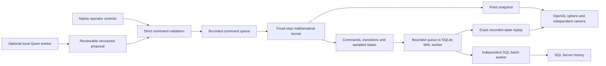

# One point, independent subsystems

`model.py` validates input and owns the state shape. `kernel.py` owns one identity and one authoritative point, projections, trajectories and idealized collision behavior. It imports no UI, database, model client or numerical GPU library. `runtime.py` schedules fixed simulation steps and publishes copied snapshots. It never opens a database connection. `render.py` draws the sphere using a verified OpenGL context. The GUI reads snapshots and queues commands; camera state never enters the kernel.

`history.py` owns local commit batches and independent SQL replication. SQL failures do not block local commits. The recorder gives samples a bounded loss policy; commands and transitions use critical queue admission. Queue saturation can stop the simulation worker, but cannot block the renderer or silently report success. `ai.py` contacts only a configured loopback Ollama endpoint, parses bounded JSON and revalidates it. The GUI displays the proposal and requires an explicit apply action. AI responses are interpretations, not measurements.

## Boundaries and capacity

The command queue holds 128 requests; scheduled commands are capped at 1,024. The recent projection lookup is pruned at 2,048 records; full lifecycle events remain in history. The journal queue holds 8,192 records, batches at most 512 records or 25 ms of arrivals, and uses SQLite `synchronous=FULL` with WAL. The default local payload budget is 256 MiB plus 16 MiB reserved for critical records. Database indexes and WAL mean physical disk use exceeds the payload budget. Samples beyond the sample budget are dropped with explicit gap events. On critical reserve exhaustion the engine faults and reports the condition. Histories are never deleted automatically; archive the data directory and start a new one. This is bounded capacity, not indefinite archival storage.

SQL replication reads committed unreplicated records in batches. `(session_id, seq)` is the idempotency key. The SQL transaction commits before the local acknowledgement flag. If acknowledgement is lost, replaying that batch uses conditional inserts and cannot duplicate IDs in the tested single-replica topology. One application process per data directory is supported; concurrent replicas targeting the same journal are outside the alpha contract.

`POINT_ENTITIES` and `POINT_SESSIONS` are metadata tables. `POINT_EVENTS` is the append-only chronological event store. `POINT_STATE_SAMPLES`, `POINT_COMMANDS`, `POINT_TRAJECTORIES`, `POINT_INTERACTIONS`, `POINT_AI_INTERPRETATIONS` and `POINT_EXPERIMENTS` are logical views, preserving the requested domain names without multiplying high-frequency writes. Typed X/Y/Z/tick columns support efficient queries; full state/command JSON preserves the versioned contract. Migration 001 is additive and idempotent.

Replay displays the exact sampled coordinates and geometry in event order, at recorded simulation timestamps. It never moves the live kernel. Sampling gaps are not reconstructed as measured states. Deterministic reexecution is separately tested against identical command inputs and fixed ticks on this Python/math runtime; bit-identical cross-platform transcendental results are not promised.
